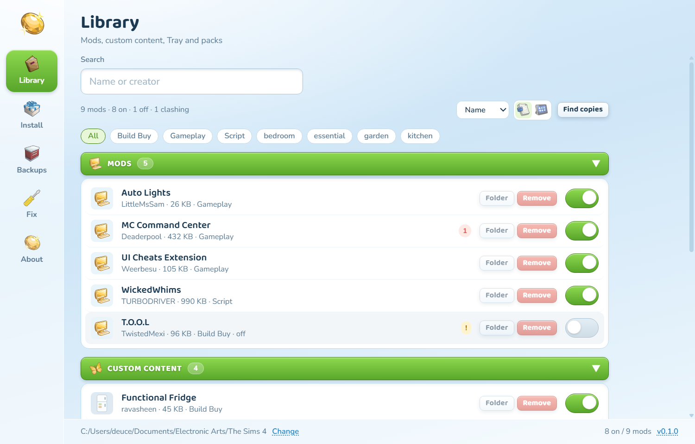
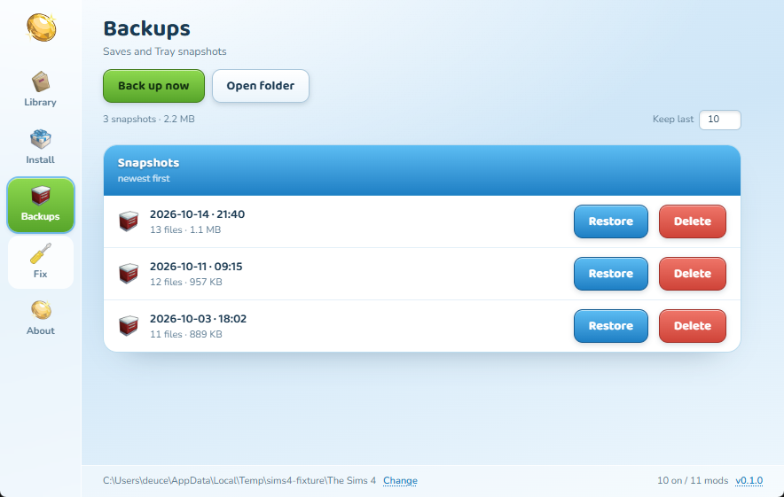
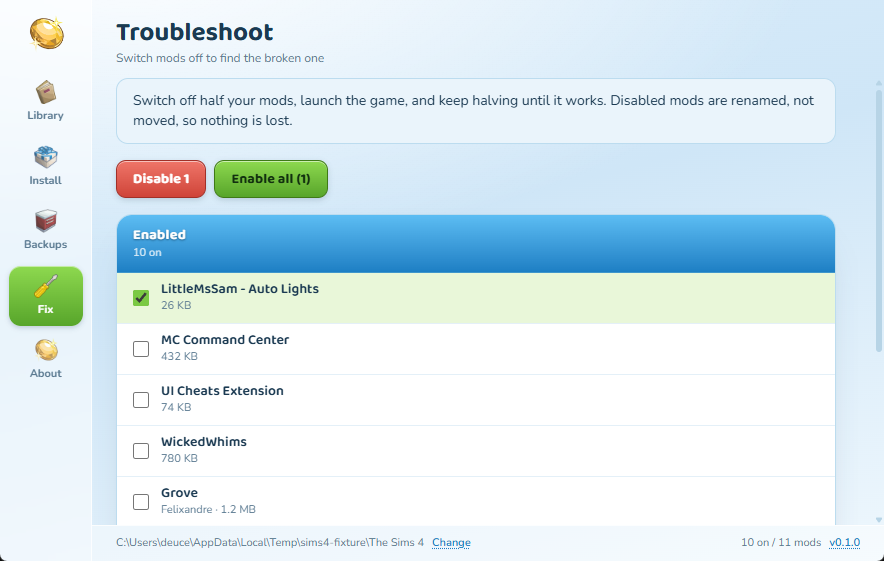

<p align="center">
  
</p>

<h1 align="center">NooBoo</h1>

<p align="center">A Sims 4 mod manager that backs up your saves before it touches anything. Made for my sister.</p>



## Download

| Platform | File | Note |
|---|---|---|
| Windows, installer | [NooBoo-windows-amd64-installer.exe](https://github.com/d3uceY/NooBoo/releases/latest/download/NooBoo-windows-amd64-installer.exe) | Bundles WebView2 |
| Windows, portable | [NooBoo-windows-amd64.exe](https://github.com/d3uceY/NooBoo/releases/latest/download/NooBoo-windows-amd64.exe) | Run it, no install |
| macOS, Apple Silicon | [NooBoo-macos-arm64.dmg](https://github.com/d3uceY/NooBoo/releases/latest/download/NooBoo-macos-arm64.dmg) | |
| macOS, Intel | [NooBoo-macos-amd64.dmg](https://github.com/d3uceY/NooBoo/releases/latest/download/NooBoo-macos-amd64.dmg) | |
| Linux, x86-64 | [NooBoo-linux-amd64](https://github.com/d3uceY/NooBoo/releases/latest/download/NooBoo-linux-amd64) | `chmod +x` first |
| Linux, .deb | [NooBoo-linux-amd64.deb](https://github.com/d3uceY/NooBoo/releases/latest/download/NooBoo-linux-amd64.deb) | Adds a menu entry |

Every release ships a `SHA256SUMS.txt`. The app checks for a newer stable release on launch and tells you once, with a link to it. The version in the footer opens the releases page.

## What it does

**Library.** Your mods and CC in one list. A switch turns one off or on, and hovering a row gives you its folder or removes it. Removed mods go to quarantine, not the bin.

**Install.** Pick a `.package`, `.ts4script`, `.zip`, or a whole folder. It lands in `Mods/<name>/`, and CC is filed under its creator. The backup checkbox is on by default.

**Backups.** Snapshots of `saves` and `Tray` whenever you want, and before every install. Restoring moves your current saves aside instead of overwriting them. Keeps the last ten, and you can change that.

**Fix.** Tick half your mods and switch them off, launch the game, repeat until it boots. Off mods are renamed (`.package` becomes `.package.off`), so nothing moves and nothing is lost. Above the list, NooBoo reads the game's own `lastException.txt` and names the mod its stack points at, with a button to switch just that one off.

<table>
<tr>
<td></td>
<td></td>
</tr>
</table>

## First launch

NooBoo isn't signed, so your OS will warn you once. The source is right here.

- **Windows:** SmartScreen, then **More info**, then **Run anyway**
- **macOS:** drag NooBoo to Applications first. If it's blocked, **System Settings → Privacy & Security → Open Anyway**
- **Linux:** `chmod +x NooBoo-linux-amd64 && ./NooBoo-linux-amd64`

Then point it at your Sims 4 folder. If it's in the usual Documents/Electronic Arts/The Sims 4 spot, NooBoo finds it for you.

## Build from source

Needs Go 1.26+, Node 24+, and the [Wails v3 CLI](https://v3alpha.wails.io/).

```bash
go install github.com/wailsapp/wails/v3/cmd/wails3@latest
go mod tidy
cd frontend && npm install && cd ..
wails3 generate bindings -clean -ts
wails3 dev      # hot reload
wails3 build    # bin/nooboo
```

Tests: `go test ./services/...`

## Docs

[How NooBoo works](docs/FEATURES.md) covers the screens, what talks to what, and what happens on disk.

## Contributing

[CONTRIBUTING.md](CONTRIBUTING.md). Bug reports are as welcome as patches.

## Credits

Icons and the app icon come from **TheSimKid's Sims 4 Modder Icons** pack. The Sims and the plumbob belong to Electronic Arts. NooBoo is unofficial and not affiliated with EA or Maxis.

## License

[MIT](LICENSE)
