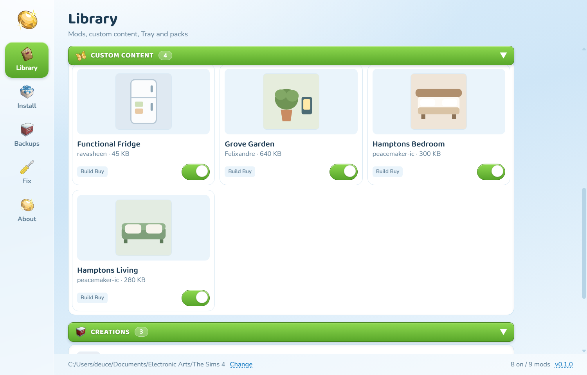
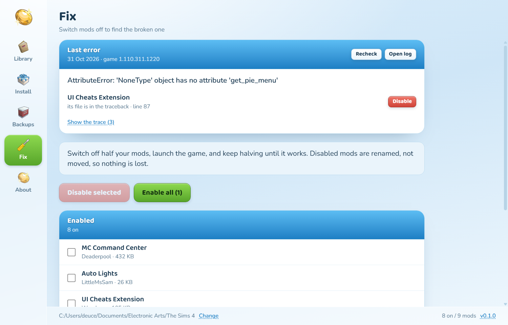

<p align="center">
  
</p>

<h1 align="center">NooBoo</h1>

<p align="center">A Sims 4 mod manager that backs up your saves before it touches anything. Built for my sis. Probably her taste too.</p>


## Download

| Platform | File | Note |
|---|---|---|
|  Windows, installer | [NooBoo-windows-amd64-installer.exe](https://github.com/d3uceY/NooBoo/releases/latest/download/NooBoo-windows-amd64-installer.exe) | Bundles WebView2 |
|  Windows, portable | [NooBoo-windows-amd64.exe](https://github.com/d3uceY/NooBoo/releases/latest/download/NooBoo-windows-amd64.exe) | Run it, no install |
|  macOS, Apple Silicon | [NooBoo-macos-arm64.dmg](https://github.com/d3uceY/NooBoo/releases/latest/download/NooBoo-macos-arm64.dmg) | |
|  macOS, Intel | [NooBoo-macos-amd64.dmg](https://github.com/d3uceY/NooBoo/releases/latest/download/NooBoo-macos-amd64.dmg) | |
|  Linux, x86-64 | [NooBoo-linux-amd64](https://github.com/d3uceY/NooBoo/releases/latest/download/NooBoo-linux-amd64) | `chmod +x` first |
|  Linux, .deb | [NooBoo-linux-amd64.deb](https://github.com/d3uceY/NooBoo/releases/latest/download/NooBoo-linux-amd64.deb) | Adds a menu entry |

Every release ships a `SHA256SUMS.txt`. The app checks for a newer stable release on launch and tells you once, with a link to it. The version in the footer opens the releases page.

## What it does

**Library.** Mods, CC, Tray creations and installed packs in one place. Real package thumbnails and kinds (CAS, Build Buy, Gameplay, Script), search, sort by name/creator/size/newest, filters, tags, clash badges, and a duplicate finder. Switch off or on, open the folder, or remove. Removed files go to quarantine.

Every package that ships a preview picture shows it, in a row or in grid view.



**Install.** Pick a `.package`, `.ts4script`, `.zip`, or folder, or drop it on the window. Files land in `Mods/<name>/` with their folders intact; a lot or household goes to `Tray/`. CC is filed under its creator. Backup is on by default.

**Backups.** Snapshots of `saves` and `Tray`, on demand and before every install. Restoring moves current saves aside. Keeps the last ten (configurable).

**Fix.** Switch off half your mods, launch, repeat until the game boots. Off mods are renamed (`.package` becomes `.package.off`). NooBoo also reads `lastException.txt`, names the mod its stack points at, and can switch just that one off.

**Packs.** Every installed expansion, game pack, stuff pack and kit, each with a switch. Switching one off writes the game's own `packstoskipmount` line — nothing is moved or uninstalled.

<table>
<tr>
<td></td>
<td></td>
</tr>
</table>

## First launch

NooBoo isn't signed, so your OS will warn you once. The source is right here.

- **Windows:** SmartScreen, then **More info**, then **Run anyway**
- **macOS:** drag NooBoo to Applications first. If it's blocked, **System Settings → Privacy & Security → Open Anyway**
- **Linux:** `chmod +x NooBoo-linux-amd64 && ./NooBoo-linux-amd64`

Then point it at your Sims 4 folder. If it's in the usual Documents/Electronic Arts/The Sims 4 spot, NooBoo finds it for you.

## Build from source

Needs Go 1.26+, Node 24+, and the [Wails v3 CLI](https://v3alpha.wails.io/).

```bash
go install github.com/wailsapp/wails/v3/cmd/wails3@latest
go mod tidy
cd frontend && npm install && cd ..
wails3 generate bindings -clean -ts
wails3 dev      # hot reload
wails3 build    # bin/nooboo
```

Tests: `go test ./services/...`

## Docs

[How NooBoo works](docs/FEATURES.md) covers the screens, what talks to what, and what happens on disk.

## Contributing

[CONTRIBUTING.md](CONTRIBUTING.md). Bug reports are as welcome as patches.

## Credits

Icons and the app icon come from **TheSimKid's Sims 4 Modder Icons** pack. The Sims and the plumbob belong to Electronic Arts. NooBoo is unofficial and not affiliated with EA or Maxis.

## License

[MIT](LICENSE)
