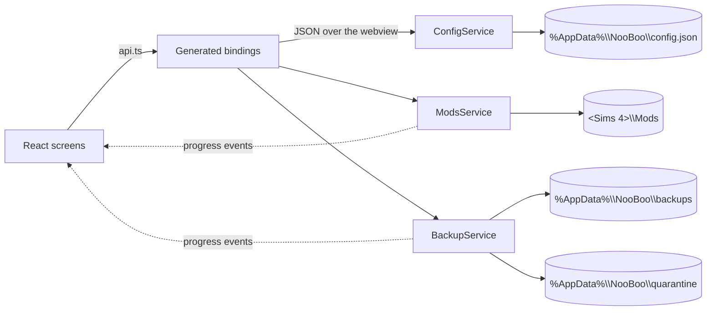

# How NooBoo works

NooBoo is a Wails v3 desktop app: a Go backend that owns every file operation, and a React frontend that renders it. There is no server, no account, and no database — the player's own folder layout is the data.

## Screens

| Screen | Does | Writes to disk |
|---|---|---|
| **Library** | Lists every mod and CC pack, toggles them, opens a folder, removes a mod | Renames files, moves removed mods to quarantine |
| **Install** | Copies a downloaded `.package`, `.ts4script` or `.zip` into `Mods/<name>/` | Creates folders, copies files, may back up first |
| **Backups** | Snapshots `saves` + `Tray`, restores, deletes, manages storage | Copies, moves, deletes your own snapshots |
| **Fix** | Disables many mods at once so you can bisect a broken game; reads the game's own error log | Renames files, reads `lastException.txt` |
| **About** | Version, credits, and whether a newer release exists | Nothing |

## How it connects



Every exported Go method becomes a typed TypeScript function. `frontend/src/lib/api.ts` is the only file that imports them, so a bindings change stays a one-file diff.

Long file work runs in the request goroutine and reports progress on a `progress` event. The frontend shows a modal bar while `phase` is `Backing up` or `Restoring`.

## Under the hood

### Finding the game folder

Detection looks for `Documents/Electronic Arts/The Sims 4`, then `OneDrive/Documents/...` for redirected installs. A folder is accepted when it has **two or more** of `saves`, `Tray`, `Mods`, `Options.ini`, `GameVersion.txt`, `UserSetting.ini` — a fresh install has no `Mods` folder yet.

Picking the wrong level is common, so validation retries against `root/The Sims 4` and `root/Electronic Arts/The Sims 4` before rejecting. A rejected folder is never saved.

### Enabling and disabling

The engine only loads `.package` and `.ts4script`. Disabling renames to `.package.off`; enabling strips the suffix. Nothing moves, so a mod folder keeps its shape and the state survives a rescan.

`Mods/<Name>/` is read as a mod. `Mods/<Creator>/<Name>/` is read as CC. A mod counts as enabled when at least one of its files still has a loadable extension.

### The last error

The game writes every script error to `lastException.txt` in its own folder, in a format meant for a parser: a `<report>` block with `createtime`, `buildsignature`, a `categoryid` that is often an unclosed `desync://` URL, and a `<desyncdata>` blob holding the traceback with `&#13;&#10;` for line breaks. One file can hold several reports.

NooBoo reads it as text, not as strict XML, because several of those tags do not nest. It takes the newest report, prefers the engine's own `j[mal|g] …` summary line over the exception type at the end, and cuts the install path off each frame so a line fits on screen.

Matching happens in two passes. A frame whose path sits under `Mods` is a direct hit, so the folder name becomes the suspect. If the log was written somewhere else — a moved folder, a OneDrive redirect — the suspect is matched by folder name instead. Frames under `T:\InGame` or `Game\Bin` are the engine's own code and are ignored, which is why an all-game stack blames nobody and says so.

No network is involved. There is no community compatibility list behind this and no update lookup for a package file; the answer comes only from what the log says.

### Installing

```
.package / .ts4script   → Mods/<name>/file
.zip                    → Mods/<name>/*.package (flattened, readme.txt dropped)
CC                      → Mods/<creator>/<name>/
```

Names pass through `folderSafe` to strip `\ / : * ? " < > |`. `.rar` and `.7z` are refused with a message rather than silently failing, because they need an external extractor.

### Backups

A snapshot is a plain copy of `saves` and `Tray` under a timestamped folder:

```
%AppData%\NooBoo\
  backups\2026-10-30_18-04-11\
    saves\
    Tray\
    backup.json      ← written LAST, presence means "complete"
  quarantine\
    2026-10-30_18-05-20\saves\   ← parked by the last restore
```

The manifest is the completeness marker. A folder without one is debris from a crash: hidden from the list and swept before the next backup. Folders touched in the last ten minutes are skipped, so a copy in flight can't be swept out from under itself.

**Restore never deletes.** It counts the snapshot's files first, refuses an empty one, then moves the live `saves`/`Tray` into `quarantine/` before copying the snapshot back. A wrong restore is recoverable until you empty the quarantine.

**Retention** keeps the last N snapshots (default 10, set on the Backups screen). Pruning runs after each successful backup.

### Removing a mod

`Delete` moves the folder into `quarantine/` instead of shredding it. It lands next to restore backups, so the same **Empty** control reclaims both.

### Safety rules

- Ids are paths. Every one is resolved and must stay inside `Mods`, or the call is rejected.
- A partial backup is deleted, never left looking restorable.
- A corrupt `config.json` falls back to defaults instead of failing to start.
- Deleting a backup cannot escape the backups folder.

### Updates

On launch the app asks GitHub for `releases/latest`, which excludes drafts and pre-releases. The tag is compared numerically against the build version (`v0.2.0` beats `v0.1.9`), and anything with a `-beta` or `+build` suffix is ignored rather than offered.

A source build reports `dev` and never calls the API. A failed check — offline, rate limited, malformed JSON — reads as "no update" and stays silent; the About screen can retry on demand. Opening the download goes through `OpenRelease`, which refuses any URL outside this repo.

The version itself is stamped by `build/scripts/set-version.sh` during a release build, which rewrites `services/version.go` from the git tag.

## Where things live

| Path | Contents |
|---|---|
| `<Sims 4 folder>` | Yours. The app only reads folder names and rewrites extensions inside `Mods`. |
| `%AppData%\NooBoo\config.json` | Game folder, retention count |
| `%AppData%\NooBoo\backups\` | Snapshots |
| `%AppData%\NooBoo\quarantine\` | Restores parked, mods removed |

## Source map

| File | Role |
|---|---|
| `main.go` | Window, service registration |
| `services/config.go` | Settings, folder detection and validation |
| `services/mods.go` | Scan, install, toggle, remove |
| `services/backup.go` | Snapshot, restore, prune, storage |
| `services/files.go` | Copy, totals, name sanitising, Explorer |
| `models/models.go` | The Go ↔ TypeScript contract |
| `frontend/src/lib/api.ts` | The only bindings import |
| `frontend/src/ui/` | Design system: Panel, Button, Dialog, Section, Field, Switch, ProgressBar |
