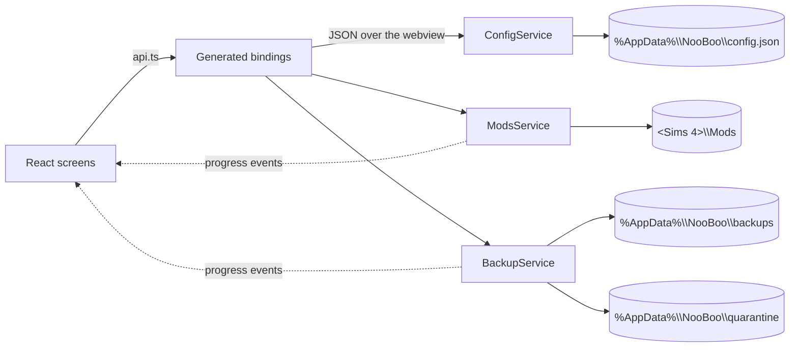

# How NooBoo works

NooBoo is a Wails v3 desktop app: a Go backend that owns every file operation, and a React frontend that renders it. There is no server, no account, and no database — the player's own folder layout is the data.

## Screens

| Screen | Does | Writes to disk |
|---|---|---|
| **Library** | Lists every mod, CC pack, Tray creation and installed pack. Toggles mods, opens a folder, removes a mod, shows clashes, finds duplicate files, tags mods | Renames files, moves removed files to quarantine |
| **Install** | Copies a downloaded `.package`, `.ts4script` or `.zip` into `Mods/<name>/`, or a lot/household into `Tray/`. Files can be dropped on the window | Creates folders, copies files, may back up first |
| **Backups** | Snapshots `saves` + `Tray`, restores, deletes, manages storage | Copies, moves, deletes your own snapshots |
| **Fix** | Disables many mods at once so you can bisect a broken game; reads the game's own error log | Renames files, reads `lastException.txt` |
| **About** | Version, credits, and whether a newer release exists | Nothing |

## How it connects



Every exported Go method becomes a typed TypeScript function. `frontend/src/lib/api.ts` is the only file that imports them, so a bindings change stays a one-file diff.

Long file work runs in the request goroutine and reports progress on a `progress` event. The frontend shows a modal bar while `phase` is `Backing up` or `Restoring`.

## Under the hood

### Finding the game folder

Detection looks for `Documents/Electronic Arts/The Sims 4`, then `OneDrive/Documents/...` for redirected installs, then every Steam library — including the Windows Documents inside a Proton prefix — plus Heroic, Lutris and plain Wine. A folder is accepted when it has **two or more** of `saves`, `Tray`, `Mods`, `Options.ini`, `GameVersion.txt`, `UserSetting.ini` — a fresh install has no `Mods` folder yet.

Picking the wrong level is common, so validation retries against `root/The Sims 4` and `root/Electronic Arts/The Sims 4` before rejecting. A rejected folder is never saved.

### Enabling and disabling

The engine only loads `.package` and `.ts4script`. Disabling renames to `.package.off`; enabling strips the suffix. `.disabled` — the suffix other managers use — is read the same way and stripped on enable, so a library that came from another tool still works. Nothing moves, so a mod folder keeps its shape and the state survives a rescan.

`Mods/<Name>/` is read as a mod. `Mods/<Creator>/<Name>/` is read as CC. A folder holding a `.ts4script` one level down is one mod, not a creator folder. A mod counts as enabled when at least one of its files still has a loadable extension.

### Looking inside a package

`.package` files are DBPF archives: a header, a table of resources, then the data. NooBoo reads only the table — never the resource bodies. From it:

- **Kind.** Any CAS resource labels the mod `CAS`; object resources `Build Buy`; tuning `Gameplay`; a `.ts4script` is `Script`. Everything else is `Package`.
- **Thumbnail.** Creator previews are embedded as PNG or JPEG. The scan keeps the sharpest image under 256 KB, cached by path, size and mtime.
- **Resource keys.** Type/group/instance triples, retained for packages under 8192 resources and used to detect mods that override each other.

A package that won't parse is still listed, by name. Nothing is inferred from a broken file.

### Clashes, copies, advisories

- **Clashes** pair enabled mods by folder name, by version token (`Hair v1` next to `Hair v2`), or by a shared resource key. A pair is capped at eight partners per mod, and can be ignored once; the ignored pair is remembered in config.
- **Copies** are found on demand, not on every scan. Files are grouped by size first, then hashed with SHA-256. The keeper is the copy that is on, nearest the top of Mods, oldest. Extras move to quarantine one file at a time.
- **Advisories** are a local list of mods reported broken, matched by file identity. The shipped list is empty; `%AppData%\NooBoo\advisories.json` can add entries without a release.

### Installs

```
.package / .ts4script   → Mods/<name>/file
.zip / folder           → Mods/<name>/, folders preserved, one wrapper dropped
CC                      → Mods/<creator>/<name>/
tray set                → Tray/, every file of the set
```

A zip or folder that contains a `0x…!0x….trayitem` is routed to `Tray/` instead. A picked tray file pulls its siblings (payload, thumbnails, portraits) from the same folder. Tray files are written to a `.part` name and renamed into place.

Non-loadable files (readmes, screenshots) are skipped. A path that would escape the destination is dropped. A relative path taken twice keeps the first copy. `.off` and `.disabled` files keep their suffix, so a folder of half-switched-off mods arrives in the state it was in. Names pass through `folderSafe` to strip `\ / : * ? " < > |`. `.rar` and `.7z` are refused with a message rather than silently failing.

### Tray

A tray item is a set of files sharing one instance: a `.trayitem` (name and creator, a small protobuf), a payload (`.blueprint`, `.room` or `.householdbinary`), thumbnails and per-sim portraits. Thumbnails are JPEGs the game XORs with a fixed key; NooBoo undoes that so the Library can show the lot or household.

### Packs

Packs are `EP`, `GP`, `SP` and `FP` folders in the game install. Switching one off writes the same `packstoskipmount` line the game's own Pack Selection screen writes into `UserSetting.ini`; nothing moves. The install is found automatically or picked once on the Library screen. Changes apply on the next launch.

### Tags

A mod can carry up to 12 labels of 24 characters. Tags are stored in config against the path the mod has while enabled, so they survive a toggle. Renaming the file or folder loses the tag.

### The last error

The game writes every script error to `lastException.txt` in its own folder, in a format meant for a parser: a `<report>` block with `createtime`, `buildsignature`, a `categoryid` that is often an unclosed `desync://` URL, and a `<desyncdata>` blob holding the traceback with `&#13;&#10;` for line breaks. One file can hold several reports.

NooBoo reads it as text, not as strict XML, because several of those tags do not nest. It takes the newest report, prefers the engine's own `j[mal|g] …` summary line over the exception type at the end, and cuts the install path off each frame so a line fits on screen.

Matching happens in two passes. A frame whose path sits under `Mods` is a direct hit, so the folder name becomes the suspect. If the log was written somewhere else — a moved folder, a OneDrive redirect — the suspect is matched by folder name instead. Frames under `T:\InGame` or `Game\Bin` are the engine's own code and are ignored, which is why an all-game stack blames nobody and says so.

No network is involved. The advisory list is a local file, and package files are never looked up online; the answer comes only from what the log says.

### Tidy up

A player who drops files straight into `Mods` gets one row per file. `Tidy` (the small button beside the search box, shown only while loose files exist) moves each one into a folder named after it, which is the shape `Install` already writes.

Files sharing a stem land in the same folder, so `WickedWhims.package` and `WickedWhims.ts4script` end up with one switch instead of two. The name is taken verbatim, which keeps the conventions players use by hand: `!MCCC` and `[Harrie] Cottage Garden` keep their prefixes, and `Creator_Item` becomes a `Creator_Item` folder. `.off` files move without being switched back on.

Three things are left alone and reported: a file whose folder name already exists as a folder with no loadable files in it (a creator folder — moving in would collapse it into one mod), a file whose name is already taken inside the target folder, and anything that is not a `.package` or `.ts4script`. Nothing is deleted, so a wrong move is a drag back in Explorer.

### Backups

A snapshot is a plain copy of `saves` and `Tray` under a timestamped folder:

```
%AppData%\NooBoo\
  backups\2026-10-30_18-04-11\
    saves\
    Tray\
    backup.json      ← written LAST, presence means "complete"
  quarantine\
    2026-10-30_18-05-20\saves\   ← parked by the last restore
```

The manifest is the completeness marker. A folder without one is debris from a crash: hidden from the list and swept before the next backup. Folders touched in the last ten minutes are skipped, so a copy in flight can't be swept out from under itself.

**Restore never deletes.** It counts the snapshot's files first, refuses an empty one, then moves the live `saves`/`Tray` into `quarantine/` before copying the snapshot back. A wrong restore is recoverable until you empty the quarantine.

**Set aside** is a window of its own, opened from the `View` button on Backups. It lists every parked folder with its size and the `Put back` that returns it. Putting one back parks whatever it replaces and deletes the entry it came from; a removed mod that is already in Mods is refused rather than overwritten.

**Retention** keeps the last N snapshots (default 10, set on the Backups screen). Pruning runs after each successful backup.

### Removing a mod

`Delete` moves the folder into `quarantine/` instead of shredding it. It lands next to restore backups, so the same **Empty** control reclaims both and **View** can put one back.

### Safety rules

- Ids are paths. Every one is resolved and must stay inside `Mods`, or the call is rejected.
- A partial backup is deleted, never left looking restorable.
- A corrupt `config.json` falls back to defaults instead of failing to start.
- Deleting a backup cannot escape the backups folder.

### Updates

On launch the app asks GitHub for `releases/latest`, which excludes drafts and pre-releases. The tag is compared numerically against the build version (`v0.2.0` beats `v0.1.9`), and anything with a `-beta` or `+build` suffix is ignored rather than offered.

A source build reports `dev` and never calls the API. A failed check — offline, rate limited, malformed JSON — reads as "no update" and stays silent; the About screen can retry on demand. Opening the download goes through `OpenRelease`, which refuses any URL outside this repo.

The version itself is stamped by `build/scripts/set-version.sh` during a release build, which rewrites `services/version.go` from the git tag.

## Where things live

| Path | Contents |
|---|---|
| `<Sims 4 folder>` | Yours. The app only reads folder names, rewrites extensions inside `Mods`, and writes the pack-skip line in `UserSetting.ini`. |
| `%AppData%\NooBoo\config.json` | Game folder, game install, retention count, tags, ignored clashes |
| `%AppData%\NooBoo\advisories.json` | Optional local advisory list |
| `%AppData%\NooBoo\backups\` | Snapshots |
| `%AppData%\NooBoo\quarantine\` | Restores parked, mods removed, duplicate files set aside |

## Source map

| File | Role |
|---|---|
| `main.go` | Window, service registration, file-drop event |
| `services/config.go` | Settings, folder detection (Documents, OneDrive, Steam/Proton), install-link opening |
| `services/mods.go` | Scan, install, toggle, remove, tags |
| `services/package.go` | DBPF index, thumbnails, kind, resource keys |
| `services/conflicts.go` | Name/version/resource clashes and ignored pairs |
| `services/duplicates.go` | Size prefilter, SHA-256 sets, file set-aside |
| `services/advisories.go` | Advisory list and identity matching |
| `services/tray.go` | Tray scan, thumbnails, install routing |
| `services/packs.go` | Pack list and `packstoskipmount` editing |
| `services/backup.go` | Snapshot, restore, prune, storage, quarantine |
| `services/files.go` | Copy, totals, name sanitising, Explorer |
| `models/models.go` | The Go ↔ TypeScript contract |
| `frontend/src/lib/api.ts` | The only bindings import |
| `frontend/src/ui/` | Design system: Panel, Button, Dialog, Section, Field, Switch, ProgressBar |
